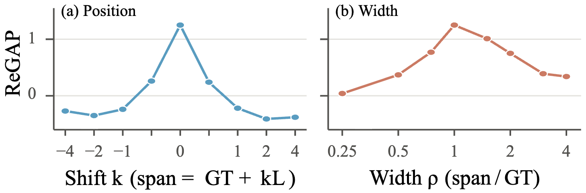
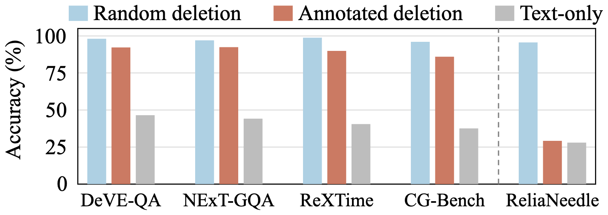

# When Does Temporal Grounding Help Video Reasoning?

<p align="center">
    📃 <a href="" target="_blank">Paper</a> | 🤗 <a href="" target="_blank">Model</a> | 🤗 <a href="" target="_blank">Training_Data</a> | 📊 <a href="relianeedle/" target="_blank">Benchmark</a>
</p>

#### [Yan&nbsp;Shu](https://shuyansy.github.io/)<sup>1</sup>, [Thomas&nbsp;De&nbsp;Min](https://scholar.google.com/citations?user=fnh_i0cAAAAJ&hl=en)<sup>1</sup>, [Moreno&nbsp;D'Incà](https://scholar.google.com/citations?user=tdTJsOMAAAAJ&hl=en)<sup>1</sup>, [Massimiliano&nbsp;Mancini](https://mancinimassimiliano.github.io/)<sup>1</sup>, and [Paolo&nbsp;Rota](https://paolorota.eu/)<sup>1</sup>

<sup>1</sup> MHUG, University of Trento, Italy

✨ **Highlights**

**(i) ReGAP, a reliance metric without ground-truth spans.** ReGAP compares the confidence change after deleting the
predicted span with that after deleting equally long random segments. We validate it on ReliaNeedle, a controlled
needle-in-a-haystack benchmark whose answers require the evidence inside the annotated span, and find that most temporally grounded
reasoning (TGR) models rely on their predicted spans less than their pretrained backbones do.

**(ii) EviCe, evidence-certified training data.** Our pipeline RelyGen annotates VideoQA pairs with correctly located,
necessary evidence spans, and keeps a sample only if its span is sufficient and necessary for the answer. Training on
these 20k samples more than doubles ReGAP.

**(iii) A training recipe that builds reliance.** Supervised fine-tuning on EviCe couples answering with localization,
and GRPO with a grounding-only reward then improves both reliance and accuracy, whereas rewarding answers erodes reliance.
Better temporal grounding improves accuracy only for such high-reliance models.

## ReGAP

For every item the model answers once with the full video $v$. Let $p(\cdot)$ be its probability for its own answer
(renormalised over the options), $\hat s$ its predicted span and $r_1,\dots,r_K$ random contiguous blocks with the same
number of frames, placed outside $\hat s$. We delete each of them separately, keep the prompt fixed, and compute

$$c = \operatorname{logit}\Big(\tfrac1K\sum_k p(v\setminus r_k)\Big) - \operatorname{logit}\big(p(v\setminus \hat s)\big),\qquad
\mathrm{ReGAP} = \frac{\mathbb E[c]}{\tau},\quad \tau = \mathbb E\big[|\operatorname{logit} p(v)|\big].$$

ReGAP = 0: the predicted span matters no more than random frames. ReGAP = 1: deleting it typically brings the answer
probability to about 0.5. Conventions (clipping, refusals, wide spans) are documented in [`regap/metric.py`](regap/metric.py)
and [`evaluation/utils/deletion.py`](evaluation/utils/deletion.py).

<p align="center">
  
</p>

*Validating ReGAP with controlled spans on ReliaNeedle.* The predicted span of Qwen2.5-VL-7B is replaced with the
ground-truth span of length $L$, either (a) shifted in position by $kL$ or (b) scaled in width by $\rho$ around its center.

```python
import json, regap
items = [json.loads(l) for l in open("evaluation/examples/relianeedle/qwen2.5-vl-7b.jsonl")]
print(regap.summarize(items))   # acc, r_at_0.3, regap, regap_hit, regap_miss, ...
print(regap.bootstrap(items))   # 95% CI with tau re-estimated in every resample
```

## Reproduce Table 1 (no GPU)

```bash
python evaluation/compute_regap.py evaluation/examples/relianeedle/*.jsonl
```

| Model | Acc. | R@0.3 (%) | ReGAP All | Hit | Miss |
|---|---|---|---|---|---|
| Qwen2.5-VL-7B | 57.2 | 46.0 | 0.598 | 0.945 | 0.302 |
| Qwen3-VL-4B | 57.4 | 55.5 | 0.711 | 1.026 | 0.320 |
| VisionCoach | 65.8 | 62.3 | 0.468 | 0.763 | −0.019 |
| VideoChat-R1.5 | 61.7 | 47.1 | 0.438 | 0.863 | 0.060 |
| VideoChat-R1 | 52.6 | 46.8 | 0.375 | 0.709 | 0.081 |
| Open-o3-Video | 66.8 | 42.9 | 0.271 | 0.764 | −0.100 |
| Video-Thinker | 54.1 | 17.5 | −0.011 | 0.384 | −0.095 |
| Video-o3 | 67.3 | 64.7 | 0.611 | 0.700 | 0.448 |
| LOVE-R1 | 58.5 | 67.1 | 0.493 | 0.628 | 0.218 |
| Conan | 60.0 | 19.6 | 0.240 | 0.489 | 0.180 |
| VideoZoomer | 64.3 | 7.7 | 0.195 | 0.693 | 0.153 |
| Open-o3-Video-v2 | 65.5 | 77.4 | 0.597 | 0.651 | 0.413 |
| Ours, Qwen2.5-VL-7B (SFT + GRPO, grounding reward) | 60.8 | 81.1 | 1.147 | 1.210 | 0.874 |
| Ours, Qwen3-VL-8B (SFT + GRPO, grounding reward) | 64.6 | 75.7 | 1.225 | 1.265 | 1.101 |

Each line of the example files is one item: `id`, `gt_span`, `pred_spans`, `correct`, `n_options`, `p_full`,
`p_span_deleted` (null if the model gave no option letter after the deletion), `p_random_deleted` and `status`.
The same format is written by the evaluation script below, so you can add your own model to the table.

## Evaluate a model on ReliaNeedle

Requirements: Python ≥ 3.10, `vllm==0.11.0`, `transformers==4.57.1`, `torch==2.8.0`, `torchvision`, `decord`, `opencv-python`, `Pillow`, `numpy`.

```bash
# backbones of Table 1: 1 fps, at most 64 frames, long side 768 px, time-span prompt, at most 64 new tokens
python evaluation/eval_relianeedle.py --model Qwen/Qwen2.5-VL-7B-Instruct --sampler grid --prompt tga --max_tokens 64 \
    --annotations relianeedle/relianeedle.json --video_root /path/to/ReliaNeedle --out results/qwen2.5-vl-7b.jsonl
# our models: official Qwen sampler (1 fps, at most 128 frames), training prompt, at most 256 new tokens
python evaluation/eval_relianeedle.py --model /path/to/ours-qwen2.5-vl-7b --sampler qwen25 --prompt train --max_tokens 256 \
    --annotations relianeedle/relianeedle.json --video_root /path/to/ReliaNeedle --out results/ours.jsonl
python evaluation/compute_regap.py results/*.jsonl
```

`--num_shards N --shard_id i` splits the items over GPUs (concatenate the outputs), and `--resume` continues an interrupted run.
For a new model, pass its prompt with `--system` / `--suffix`. The script expects the predicted span as `[start, end]`
(seconds) inside `<think></think>` and the option letter inside `<answer></answer>`; for other output formats adapt
`evaluation/utils/parsing.py` (span and answer parsing, and the position of the answer token whose probabilities are read).

## Evaluate a model on Video-Oasis

[Video-Oasis](https://github.com/sejong-rcv/Video-Oasis) accuracy and ReGAP in one pass, for Qwen2.5-VL / Qwen3-VL and models
trained from them. Questions, frames (official Qwen sampler, 1 fps, at most 128 frames, RTV-Bench time windows) and answer
extraction are taken from the official repository at commit `adaa458`.

```bash
git clone https://github.com/sejong-rcv/Video-Oasis.git && git -C Video-Oasis checkout adaa458
export OASIS_REPO=$PWD/Video-Oasis OASIS_VIDEOS=/path/to/videos   # <benchmark>/videos/... (default: $OASIS_REPO/data/benchmarks/videos)
for i in 0 1 2 3 4 5 6 7; do
  CUDA_VISIBLE_DEVICES=$i python evaluation/oasis/eval_oasis.py --family qwen25 --model /path/to/ours-qwen2.5-vl-7b --prompt train \
      --out results/oasis/ours_shard${i}of8.jsonl --num_shards 8 --shard_id $i --resume &
done; wait
python evaluation/oasis/summarize_oasis.py results/oasis/ours_shard*of8.jsonl
```

Every question gets two requests with the same prompt and frames: the accuracy request (greedy, the model's repetition penalty,
up to 16,384 new tokens, official answer extraction) and an anchor request (greedy, up to 256 new tokens) that gives the answer,
the predicted span and its probability. The span and K = 3 random blocks are then deleted as for ReliaNeedle. When a deletion arm
writes no option letter, the probabilities are read at its answer slot, or after forcing one `<answer>` token; items that still
have no value are left out of ReGAP (`refusal="exclude"`). Questions whose video is not available locally are not scored.
On a 280-question subset (20 per source benchmark) we checked that this script builds the same inputs as our original evaluation
(questions, prompts, answer and span parsing; frames and deletions bitwise on a sample of videos). Its scores differ from our
archived runs by at most 0.4 accuracy points and 0.02 ReGAP, and per-question probabilities differ as much as in a rerun of the
original evaluation (vLLM outputs depend slightly on batching).
`--hf_mrope` (optional, Qwen2.5-VL) makes vLLM compute the video time positions exactly as transformers; the paper's numbers were
computed without it.

## ReliaNeedle

725 four-option questions. Each video inserts a real action clip (the *needle*, from STAR / Charades) into an unrelated
Video-MME video (the *haystack*); the question can only be answered from the needle. `relianeedle/relianeedle.json` lists
for every item the question, options, answer letter, needle span (seconds) and, for 646 of the 725 items, the source videos
and insertion position. The videos will be released after the Video-MME terms are cleared.

<p align="center">
  
</p>

*Auditing grounding annotations.* Accuracy of Qwen2.5-VL-7B on its correctly answered questions after deleting a random
span or the annotated evidence span. Text-only is the accuracy from the question and options alone, on all questions.

## Training

See [`training/README.md`](training/README.md): SFT on EviCe with LLaMA-Factory, then GRPO with verl rewarded only for
temporal grounding (`R_IoU`), for Qwen2.5-VL-7B and Qwen3-VL-8B; the same recipe in the multi-turn (tool-calling) format
on top of Video-o3 in [`training/multiturn/`](training/multiturn/README.md).

<p align="center">
  
</p>

*Evidence certification and RelyGen.* (a) A sample is kept only if two judges answer correctly from its span alone and
fail when the span is deleted. (b) Certifying TGR training data improves ReGAP, but the 2k certified samples are too few
to improve localization and accuracy, while VideoQA data is abundant but lacks evidence spans. (c) RelyGen turns VideoQA
pairs without span annotations into candidate spans and certifies them with the same tests to build EviCe.

<p align="center">
  
</p>

*Effect of the training recipe.* (a) Accuracy and ReGAP on Video-Oasis for single-turn and multi-turn models; labels on
GRPO variants denote the reward function. (b) Training dynamics on Video-Oasis for single-turn *SFT + GRPO* under
`R_IoU` or `R_ans`. (c) ReGAP on ReliaNeedle when the predicted span hits (IoU ≥ 0.3) or misses the evidence, for
single-turn (left) and multi-turn (right) models (*GRPO w/o cold-start* uses `R_ans`; *SFT + GRPO* uses `R_IoU`).

<p align="center">
  
</p>

*Grounding helps only when the answer relies on it.* (a, b) Accuracy and ReGAP on Video-Oasis as temporal grounding data
is added to single-turn GRPO with `R_IoU`. (c, d) Correcting localization at inference on ReliaNeedle. Accuracy on items
where the predicted spans of all three models in a panel miss the evidence, with the predicted span kept or replaced by a
random span of the same length or by the ground-truth evidence span (averaged over three runs).

## License

Code: Apache License 2.0 (see `LICENSE`); `evaluation/utils/vision_process.py` comes from Video-Oasis (MIT) and Qwen
(Apache-2.0), see `THIRD_PARTY_NOTICES.md`. ReliaNeedle and EviCe are for research use only; the terms of their source
datasets (Video-MME, Charades / STAR, and the EviCe sources) apply.
