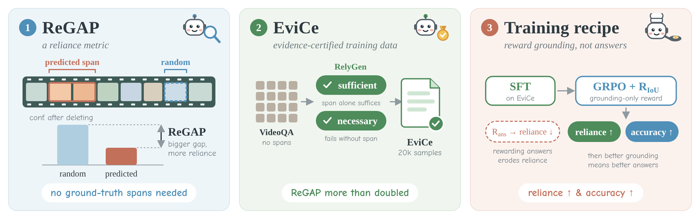
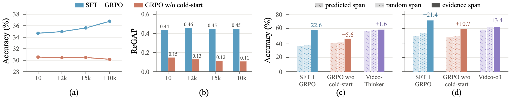

# When Does Temporal Grounding Help Video Reasoning?

<p align="center">
    📃 <a href="" target="_blank">Paper</a> | 🤗 <a href="https://huggingface.co/collections/sy1998/when-does-temporal-grounding-help-video-reasoning-6b058ea312ac2e5751e6b735" target="_blank">Model</a> | 🤗 <a href="https://huggingface.co/datasets/sy1998/EviCe" target="_blank">Training_Data</a> | 📊 <a href="relianeedle/" target="_blank">Benchmark</a>
</p>

#### [Yan&nbsp;Shu](https://shuyansy.github.io/), [Thomas&nbsp;De&nbsp;Min](https://scholar.google.com/citations?user=fnh_i0cAAAAJ&hl=en), [Moreno&nbsp;D'Incà](https://scholar.google.com/citations?user=tdTJsOMAAAAJ&hl=en), [Massimiliano&nbsp;Mancini](https://mancinimassimiliano.github.io/), and [Paolo&nbsp;Rota](https://paolorota.eu/)

<p align="center">&nbsp;<b>MHUG, University of Trento, Italy</b></p>

✨ **Highlights**

<p align="center">
  
</p>

(i) **ReGAP**, a metric of how much the answer relies on the predicted span, without ground-truth span annotations. 🔍

(ii) **EviCe**, 20k VideoQA samples with certified evidence spans; training on it more than doubles ReGAP. 🏅

(iii) **A training recipe**, SFT on EviCe followed by GRPO with a grounding-only reward, that improves both reliance and accuracy. 🍳

## ReliaNeedle Leaderboard

ReGAP measures how much the answer relies on the predicted span (0 means no more than random frames). R@0.3 is the
share of predicted spans with IoU ≥ 0.3 against the evidence.

| Model | ReGAP | Acc. (%) | R@0.3 (%) |
|---|---|---|---|
| **[Ours, Qwen3-VL-8B](https://huggingface.co/sy1998/TGR-Reliance-Qwen3-VL-8B)** | **1.225** | 64.6 | 75.7 |
| **[Ours, Qwen2.5-VL-7B](https://huggingface.co/sy1998/TGR-Reliance-Qwen2.5-VL-7B)** | **1.147** | 60.8 | 81.1 |
| Video-o3 | 0.611 | 67.3 | 64.7 |
| Open-o3-Video-v2 | 0.597 | 65.5 | 77.4 |
| LOVE-R1 | 0.493 | 58.5 | 67.1 |
| VisionCoach | 0.468 | 65.8 | 62.3 |
| VideoChat-R1.5 | 0.438 | 61.7 | 47.1 |
| VideoChat-R1 | 0.375 | 52.6 | 46.8 |
| Open-o3-Video | 0.271 | 66.8 | 42.9 |
| Conan | 0.240 | 60.0 | 19.6 |
| VideoZoomer | 0.195 | 64.3 | 7.7 |
| Video-Thinker | −0.011 | 54.1 | 17.5 |

### Evaluate on ReliaNeedle

Requirements: Python ≥ 3.10, `vllm==0.11.0`, `transformers==4.57.1`, `torch==2.8.0`, `torchvision`, `decord`, `opencv-python`, `Pillow`, `numpy`.

```bash
# reproduce the leaderboard from the released per-item results (no GPU)
python evaluation/compute_regap.py evaluation/examples/relianeedle/*.jsonl

# evaluate models
ANN=relianeedle/relianeedle.json; VID=/path/to/ReliaNeedle
python evaluation/eval_relianeedle.py --model Qwen/Qwen2.5-VL-7B-Instruct --sampler grid --prompt tga --max_tokens 64 \
    --annotations $ANN --video_root $VID --out results/qwen2.5-vl-7b.jsonl
python evaluation/eval_relianeedle.py --model sy1998/TGR-Reliance-Qwen2.5-VL-7B --sampler qwen25 --prompt train \
    --annotations $ANN --video_root $VID --out results/ours-qwen2.5-vl-7b.jsonl
python evaluation/eval_relianeedle.py --model sy1998/TGR-Reliance-Qwen3-VL-8B --sampler qwen3 --prompt train \
    --annotations $ANN --video_root $VID --out results/ours-qwen3-vl-8b.jsonl
python evaluation/compute_regap.py results/*.jsonl
```

For other models, set the prompt with `--system` / `--suffix` and adapt the span and answer parsing in
`evaluation/utils/parsing.py`.

## Evaluate a model on Video-Oasis

[Video-Oasis](https://github.com/sejong-rcv/Video-Oasis) accuracy and ReGAP in one pass, for Qwen2.5-VL / Qwen3-VL and models
trained from them. Questions, frames (official Qwen sampler, 1 fps, at most 128 frames, RTV-Bench time windows) and answer
extraction are taken from the official repository at commit `adaa458`.

```bash
git clone https://github.com/sejong-rcv/Video-Oasis.git && git -C Video-Oasis checkout adaa458
export OASIS_REPO=$PWD/Video-Oasis OASIS_VIDEOS=/path/to/videos   # <benchmark>/videos/... (default: $OASIS_REPO/data/benchmarks/videos)
for i in 0 1 2 3 4 5 6 7; do
  CUDA_VISIBLE_DEVICES=$i python evaluation/oasis/eval_oasis.py --family qwen25 --model /path/to/ours-qwen2.5-vl-7b --prompt train \
      --out results/oasis/ours_shard${i}of8.jsonl --num_shards 8 --shard_id $i --resume &
done; wait
python evaluation/oasis/summarize_oasis.py results/oasis/ours_shard*of8.jsonl
```

Every question gets two requests with the same prompt and frames: the accuracy request (greedy, the model's repetition penalty,
up to 16,384 new tokens, official answer extraction) and an anchor request (greedy, up to 256 new tokens) that gives the answer,
the predicted span and its probability. The span and K = 3 random blocks are then deleted as for ReliaNeedle. When a deletion arm
writes no option letter, the probabilities are read at its answer slot, or after forcing one `<answer>` token; items that still
have no value are left out of ReGAP (`refusal="exclude"`). Questions whose video is not available locally are not scored.
On a 280-question subset (20 per source benchmark) we checked that this script builds the same inputs as our original evaluation
(questions, prompts, answer and span parsing; frames and deletions bitwise on a sample of videos). Its scores differ from our
archived runs by at most 0.4 accuracy points and 0.02 ReGAP, and per-question probabilities differ as much as in a rerun of the
original evaluation (vLLM outputs depend slightly on batching).
`--hf_mrope` (optional, Qwen2.5-VL) makes vLLM compute the video time positions exactly as transformers; the paper's numbers were
computed without it.

## ReliaNeedle

725 four-option questions. Each video inserts a real action clip (the *needle*, from STAR / Charades) into an unrelated
Video-MME video (the *haystack*); the question can only be answered from the needle. `relianeedle/relianeedle.json` lists
for every item the question, options, answer letter, needle span (seconds) and, for 646 of the 725 items, the source videos
and insertion position. The videos will be released after the Video-MME terms are cleared.

<p align="center">
  
</p>

*Auditing grounding annotations.* Accuracy of Qwen2.5-VL-7B on its correctly answered questions after deleting a random
span or the annotated evidence span. Text-only is the accuracy from the question and options alone, on all questions.

## Training

See [`training/README.md`](training/README.md): SFT on EviCe with LLaMA-Factory, then GRPO with verl rewarded only for
temporal grounding (`R_IoU`), for Qwen2.5-VL-7B and Qwen3-VL-8B; the same recipe in the multi-turn (tool-calling) format
on top of Video-o3 in [`training/multiturn/`](training/multiturn/README.md).

<p align="center">
  
</p>

*Evidence certification and RelyGen.* (a) A sample is kept only if two judges answer correctly from its span alone and
fail when the span is deleted. (b) Certifying TGR training data improves ReGAP, but the 2k certified samples are too few
to improve localization and accuracy, while VideoQA data is abundant but lacks evidence spans. (c) RelyGen turns VideoQA
pairs without span annotations into candidate spans and certifies them with the same tests to build EviCe.

<p align="center">
  
</p>

*Effect of the training recipe.* (a) Accuracy and ReGAP on Video-Oasis for single-turn and multi-turn models; labels on
GRPO variants denote the reward function. (b) Training dynamics on Video-Oasis for single-turn *SFT + GRPO* under
`R_IoU` or `R_ans`. (c) ReGAP on ReliaNeedle when the predicted span hits (IoU ≥ 0.3) or misses the evidence, for
single-turn (left) and multi-turn (right) models (*GRPO w/o cold-start* uses `R_ans`; *SFT + GRPO* uses `R_IoU`).

<p align="center">
  
</p>

*Grounding helps only when the answer relies on it.* (a, b) Accuracy and ReGAP on Video-Oasis as temporal grounding data
is added to single-turn GRPO with `R_IoU`. (c, d) Correcting localization at inference on ReliaNeedle. Accuracy on items
where the predicted spans of all three models in a panel miss the evidence, with the predicted span kept or replaced by a
random span of the same length or by the ground-truth evidence span (averaged over three runs).

## License

Code: Apache License 2.0 (see `LICENSE`); `evaluation/utils/vision_process.py` comes from Video-Oasis (MIT) and Qwen
(Apache-2.0), see `THIRD_PARTY_NOTICES.md`. ReliaNeedle and EviCe are for research use only; the terms of their source
datasets (Video-MME, Charades / STAR, and the EviCe sources) apply.
