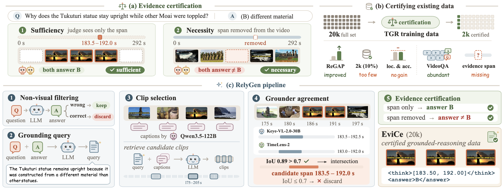
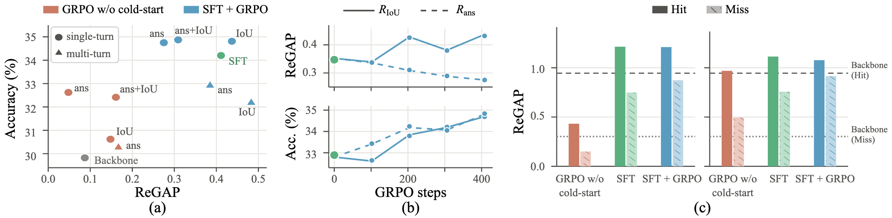

## When Does Temporal Grounding Help Video Reasoning?

<p align="center">
    📃 <a href="" target="_blank">Paper</a> | 🤗 <a href="https://huggingface.co/collections/sy1998/when-does-temporal-grounding-help-video-reasoning-6b058ea312ac2e5751e6b735" target="_blank">Model</a> | 🤗 <a href="https://huggingface.co/datasets/sy1998/EviCe" target="_blank">Training_Data</a> | 🤗 <a href="https://huggingface.co/datasets/sy1998/ReliaNeedle" target="_blank">Benchmark</a>
</p>

<h4 align="center"><a href="https://shuyansy.github.io/">Yan&nbsp;Shu</a>, <a href="https://scholar.google.com/citations?user=fnh_i0cAAAAJ&hl=en">Thomas&nbsp;De&nbsp;Min</a>, <a href="https://scholar.google.com/citations?user=tdTJsOMAAAAJ&hl=en">Moreno&nbsp;D'Incà</a>, <a href="https://mancinimassimiliano.github.io/">Massimiliano&nbsp;Mancini</a>, and <a href="https://paolorota.eu/">Paolo&nbsp;Rota</a></h4>

<p align="center">&nbsp;<b>MHUG, University of Trento, Italy</b></p>

✨ **Highlights**

<p align="center">
  
</p>

(i) **ReGAP**, measuring how much a model's answer relies on its predicted span. 🔍

(ii) **EviCe**, 20k evidence-certified VideoQA samples that more than double ReGAP. 🏅

(iii) **A training recipe**, SFT then grounding-only GRPO, raising reliance and accuracy. 🍳

## ReliaNeedle Leaderboard

ReGAP measures how much the answer relies on the predicted span (0 means no more than random frames). R@0.3 is the
share of predicted spans with IoU ≥ 0.3 against the evidence.

| Model | ReGAP | Acc. (%) | R@0.3 (%) |
|---|---|---|---|
| **[Ours, Qwen3-VL-8B](https://huggingface.co/sy1998/TGR-Reliance-Qwen3-VL-8B)** | **1.225** | 64.6 | 75.7 |
| **[Ours, Qwen2.5-VL-7B](https://huggingface.co/sy1998/TGR-Reliance-Qwen2.5-VL-7B)** | **1.147** | 60.8 | 81.1 |
| Qwen3-VL-4B | 0.711 | 57.4 | 55.5 |
| Video-o3 | 0.611 | 67.3 | 64.7 |
| Qwen2.5-VL-7B | 0.598 | 57.2 | 46.0 |
| Open-o3-Video-v2 | 0.597 | 65.5 | 77.4 |
| LOVE-R1 | 0.493 | 58.5 | 67.1 |
| VisionCoach | 0.468 | 65.8 | 62.3 |
| VideoChat-R1.5 | 0.438 | 61.7 | 47.1 |
| VideoChat-R1 | 0.375 | 52.6 | 46.8 |
| Open-o3-Video | 0.271 | 66.8 | 42.9 |
| Conan | 0.240 | 60.0 | 19.6 |
| VideoZoomer | 0.195 | 64.3 | 7.7 |
| Video-Thinker | −0.011 | 54.1 | 17.5 |

### Evaluate on ReliaNeedle

Requirements: Python ≥ 3.10, `vllm==0.11.0`, `transformers==4.57.1`, `torch==2.8.0`, `torchvision`, `decord`, `opencv-python`, `Pillow`, `numpy`.

Download ReliaNeedle (`relianeedle.json` and `videos/needle/*.mp4`) from Hugging Face:

```bash
hf download sy1998/ReliaNeedle --repo-type dataset --local-dir data/ReliaNeedle
```

```bash
ANN=data/ReliaNeedle/relianeedle.json; VID=data/ReliaNeedle
python evaluation/eval_relianeedle.py --model Qwen/Qwen2.5-VL-7B-Instruct --sampler grid --prompt tga --max_tokens 64 \
    --annotations $ANN --video_root $VID --out results/qwen2.5-vl-7b.jsonl
python evaluation/eval_relianeedle.py --model sy1998/TGR-Reliance-Qwen2.5-VL-7B --sampler qwen25 --prompt train \
    --annotations $ANN --video_root $VID --out results/ours-qwen2.5-vl-7b.jsonl
python evaluation/eval_relianeedle.py --model sy1998/TGR-Reliance-Qwen3-VL-8B --sampler qwen3 --prompt train \
    --annotations $ANN --video_root $VID --out results/ours-qwen3-vl-8b.jsonl
python evaluation/compute_regap.py results/*.jsonl
```

For other models, set the prompt with `--system` / `--suffix` and adapt the span and answer parsing in
`evaluation/utils/parsing.py`.

## Training Dataset

EviCe contains 20k VideoQA samples whose evidence spans are certified by RelyGen to be sufficient and necessary for the answer.

```bash
hf download sy1998/EviCe --repo-type dataset --local-dir data/EviCe
```

<p align="center">
  
</p>

*Evidence certification and RelyGen.* (a) A sample is kept only if two judges answer correctly from its span alone and
fail when the span is deleted. (b) Certifying TGR training data improves ReGAP, but the 2k certified samples are too few
to improve localization and accuracy, while VideoQA data is abundant but lacks evidence spans. (c) RelyGen turns VideoQA
pairs without span annotations into candidate spans and certifies them with the same tests to&nbsp;build&nbsp;EviCe.

## Training

SFT on EviCe with LLaMA-Factory, then GRPO with verl rewarded only for temporal grounding (`R_IoU`), for Qwen2.5-VL-7B
and Qwen3-VL-8B. Commands and settings are in [`training/README.md`](training/README.md), and the multi-turn
(tool-calling) version on top of Video-o3 is in [`training/multiturn/`](training/multiturn/README.md).

<p align="center">
  
</p>

*Effect of the training recipe.* (a) Accuracy and ReGAP on Video-Oasis for single-turn and multi-turn models; labels on
GRPO variants denote the reward function. (b) Training dynamics on Video-Oasis for single-turn *SFT + GRPO* under
`R_IoU` or `R_ans`. (c) ReGAP on ReliaNeedle when the predicted span hits (IoU ≥ 0.3) or misses the evidence, for
single-turn (left) and multi-turn (right) models (*GRPO w/o cold-start* uses `R_ans`; *SFT + GRPO*&nbsp;uses&nbsp;`R_IoU`).

## License

The code is released under the [Apache 2.0 License](LICENSE). ReliaNeedle and EviCe are for research use only.

## Citation

If you find this repository useful, please consider giving a star :star: and citation.

```bibtex
@article{shu2026when,
  title={When Does Temporal Grounding Help Video Reasoning?},
  author={Shu, Yan and De Min, Thomas and D'Inc{\`a}, Moreno and Mancini, Massimiliano and Rota, Paolo},
  journal={arXiv preprint},
  year={2026}
}
```

## Star History

[](https://star-history.com/#shuyansy/TGR-Reliance&Date)
